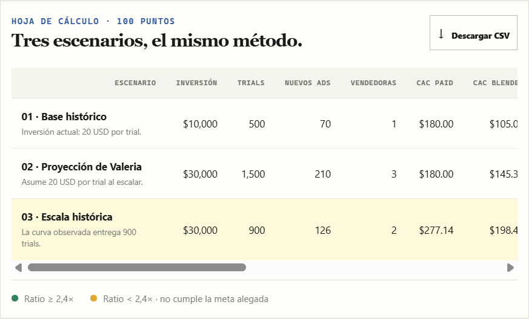
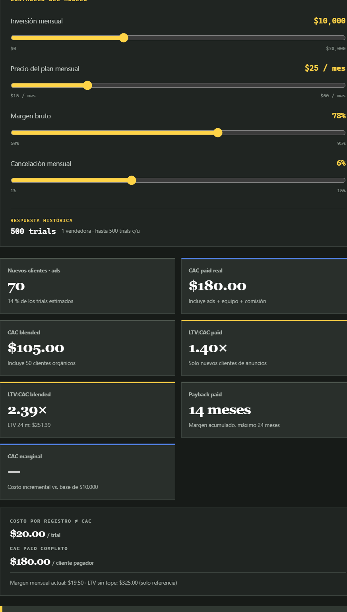
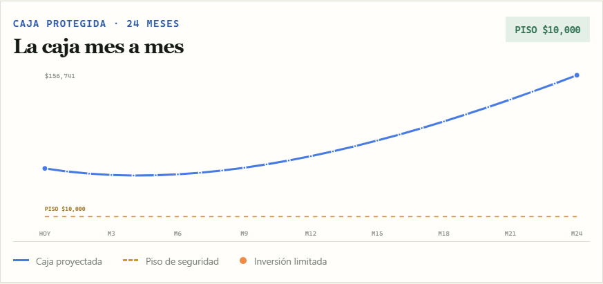

# Agendo Cyber — Unit Economics

Agendo Cyber es un panel interactivo para analizar las unit economics y la
capacidad de inversión de un SaaS de agenda y cobros para barberías. Presenta el
**caso B** como una herramienta de decisión para el equipo fundador: ¿conviene
triplicar la inversión en anuncios o es mejor validar primero el costo real de
adquirir y recuperar un cliente?

La página convierte los supuestos del caso en comparaciones, métricas y una
proyección de caja a 24 meses. No es una aplicación de reservas para clientes ni
un sistema de administración de barberías; es un simulador financiero basado en
los datos de adquisición y operación incluidos en el proyecto.

## Capturas

Las imágenes muestran la interfaz con los valores iniciales del modelo.

### Portada y lectura inicial

Presenta la decisión, la caja disponible y el veredicto del escenario de escala.


### Comparación de escenarios

Compara la adquisición actual, la proyección optimista de Valeria y la respuesta
histórica observada al escalar.



### Tablero interactivo

Permite modificar inversión, precio, margen y churn, y muestra cómo cambian las
métricas de adquisición y valor de vida.



### Simulador de caja

Grafica la caja durante 24 meses, con el piso de seguridad y los ajustes de
inversión cuando el plan amenaza ese límite.



## ¿Qué problema resuelve?

El panel ayuda a responder preguntas que un costo por registro, por sí solo, no
resuelve:

- ¿Cuántos trials y clientes pagadores produciría una inversión mensual?
- ¿Cuánto cuesta realmente adquirir un cliente después de sumar anuncios,
  equipo comercial y comisiones?
- ¿El LTV cubre el CAC en clientes paid y en el conjunto blended?
- ¿Cuándo recupera su CAC una cohorte mensual, anual prepago u orgánica?
- ¿Qué inversión se puede sostener sin bajar de la caja mínima durante los
  próximos 24 meses?
- ¿Qué cambio sería necesario para alcanzar un LTV:CAC blended de 2,4×?

La distinción central del análisis es **trial ≠ cliente pagador** y
**costo por trial ≠ CAC**. Una campaña puede generar registros a un costo
aparentemente atractivo y aun así no ser rentable cuando se consideran
conversión, churn, margen, equipo y comisión.

## Cómo usar la página

La navegación superior lleva a los tres niveles del análisis:

El botón **Oscuro / Claro** de la barra superior cambia la apariencia de la
página. La elección se guarda en el navegador y se conserva al volver a cargar.

1. **Calculadora:** revisa los supuestos, compara los tres escenarios, consulta
   los datos de canales y la curva histórica, y descarga la tabla comparativa en
   CSV. El gráfico por cohortes muestra la recuperación del CAC a lo largo de
   24 meses.
2. **Tablero:** mueve los controles de inversión mensual, precio del plan,
   margen bruto y cancelación mensual. Las tarjetas y el umbral necesario para
   alcanzar 2,4× se recalculan con los nuevos valores.
3. **Simulador:** ajusta la proporción de nuevos clientes que elige el plan anual
   prepago. Revisa el gráfico y la tabla mensual para ver inversión, trials,
   clientes activos, entradas, costos y caja final.

Todos los importes están expresados en USD. Los valores iniciales son una base
para explorar supuestos, no un pronóstico garantizado.

## Qué muestra cada sección

### 1. Calculadora y escenarios

La comparación usa tres perspectivas con la misma conversión trial a pago:

| Escenario | Inversión | Trials | Método de estimación |
| --- | ---: | ---: | --- |
| Base histórico | USD 10.000 | 500 | Curva histórica |
| Proyección de Valeria | USD 30.000 | 1.500 | Mantiene USD 20 por trial |
| Escala histórica | USD 30.000 | 900 | Curva histórica |

La tabla calcula clientes pagadores, número de vendedores, CAC paid y blended,
CAC marginal contra el caso base, LTV a 24 meses, LTV:CAC y payback. El botón
**Descargar CSV** exporta las métricas de los escenarios actuales para analizarlas
en Excel o Google Sheets.

La sección de fuente presenta la adquisición de septiembre por canal (Meta y
Google), y los puntos observados que forman la curva histórica. Los trials entre
puntos se estiman mediante interpolación lineal; por encima de USD 30.000, el
modelo mantiene el máximo observado de 900 trials.

### 2. Tablero de unit economics

Los cuatro controles recalculan el escenario para explorar:

- **Inversión mensual:** de USD 0 a USD 30.000.
- **Precio del plan mensual:** de USD 15 a USD 60.
- **Margen bruto:** de 50 % a 95 %.
- **Cancelación mensual (churn):** de 1 % a 15 %.

El tablero presenta, entre otras, estas métricas:

- **CAC paid:** costo de adquisición dividido entre los clientes provenientes
  de anuncios.
- **CAC blended:** costo de adquisición dividido entre clientes de anuncios y
  clientes orgánicos. Los orgánicos son un supuesto fijo; no aumentan al subir
  la inversión.
- **CAC marginal:** costo incremental por cada nuevo cliente paid al comparar la
  inversión seleccionada con la base de USD 10.000.
- **LTV a 24 meses:** margen de contribución mensual esperado, acumulado durante
  un horizonte acotado y ajustado por churn.
- **LTV:CAC:** relación entre el LTV de 24 meses y el CAC correspondiente.
  La referencia del caso es 2,4×.
- **Payback:** primer mes en que el margen acumulado esperado cubre el CAC,
  dentro del horizonte de 24 meses.

El recuadro de objetivo estima la conversión trial a pago o el precio mensual
necesario para alcanzar 2,4× blended, manteniendo los demás supuestos
seleccionados. Si el umbral no es alcanzable con esos supuestos, la página lo
indica.

### 3. Simulador de caja

El simulador proyecta 24 meses y compara el plan solicitado con el piso de
seguridad. Si la inversión solicitada llevaría la caja por debajo de ese piso,
el modelo reduce automáticamente la inversión del mes hasta conservarlo cuando
sea posible. Si la caja cruzaría el piso incluso con anuncios en cero, muestra
una alerta: el ajuste de anuncios no basta y se requieren otros cambios o capital.

El gráfico resume la caja protegida; el detalle mensual muestra el cálculo de
caja, incluyendo trials, clientes nuevos, clientes activos mensuales y anuales,
margen de prepago, equipo comercial, comisiones y costos fijos. El escenario sin
corrección se usa para identificar cuándo se rompería el piso si se mantuviera la
inversión completa.

La mezcla anual se aplica a los nuevos clientes de cada mes. El modelo considera
el pago anual por adelantado y una renovación esperada del 70 % en el mes 13; los
1.150 clientes iniciales se consideran mensuales.

## Cómo se calculan las métricas

Las fórmulas principales son:

```text
Clientes paid = trials × conversión trial a pago
Vendedores = techo(trials ÷ capacidad de trials por vendedor)
Costo de adquisición = inversión + costo del equipo + comisiones
CAC paid = costo de adquisición ÷ clientes paid
CAC blended = costo de adquisición ÷ (clientes paid + clientes orgánicos)
Margen mensual por cliente = precio mensual × margen bruto
LTV 24 meses = suma del margen esperado de cada mes, ajustado por churn
LTV:CAC = LTV 24 meses ÷ CAC
```

El payback se calcula acumulando el margen esperado de la cohorte hasta recuperar
su CAC o llegar al límite de 24 meses. Si no se recupera dentro del horizonte, la
interfaz lo expresa como superior a 24 meses.

En la proyección, las entradas mensuales de los clientes del plan mensual y el
margen del prepago anual se incorporan a la caja. Por eso las cifras de entradas
del simulador representan **contribución después del margen bruto**, no ventas
brutas. Los gastos incluyen inversión en anuncios, vendedores, comisiones y
costos fijos.

## Supuestos iniciales

Los valores que alimentan el caso base son:

| Supuesto | Valor inicial |
| --- | ---: |
| Plan mensual | USD 25 |
| Plan anual prepago | USD 240 |
| Margen bruto | 78 % |
| Conversión de trial a cliente pagador | 14 % |
| Churn mensual | 6 % |
| Renovación anual esperada en el mes 13 | 70 % |
| Clientes orgánicos nuevos por mes | 50 |
| Clientes activos iniciales | 1.150 |
| Vendedores | USD 1.200 por mes; hasta 500 trials por vendedor |
| Comisión por nuevo cliente de anuncios | USD 20 |
| Costos fijos mensuales | USD 14.000 |
| Caja inicial | USD 60.000 |
| Piso de seguridad | USD 10.000 |
| Horizonte del simulador y LTV acotado | 24 meses |

Los costos directos de 22 % ya están reflejados en el margen bruto de 78 % y no
se restan una segunda vez. La curva de adquisición parte de estos datos:

| Inversión mensual | Trials históricos |
| ---: | ---: |
| USD 0 | 0 |
| USD 5.000 | 290 |
| USD 10.000 | 500 |
| USD 15.000 | 650 |
| USD 20.000 | 760 |
| USD 30.000 | 900 |

La estimación de Valeria es deliberadamente distinta: asume que el costo se
mantiene en USD 20 por trial al escalar. La página la contrasta con la curva
histórica; no la trata como un resultado observado.

## Datos y estructura del proyecto

- [`src/App.jsx`](./src/App.jsx) contiene la interfaz, controles, tablas,
  visualizaciones y descarga CSV.
- [`src/model.js`](./src/model.js) contiene los supuestos por defecto y las
  funciones de interpolación, escenarios, unit economics y proyección de caja.
- [`db.json`](./db.json) es un fixture de datos de prueba con supuestos, canales,
  escenarios y cohortes. **La página no lo consulta todavía**; los cálculos se
  generan desde `src/model.js`.
- [`docs/screenshots/`](./docs/screenshots/) contiene las capturas incluidas en
  esta documentación.

No se requiere una API ni una base de datos para ejecutar la página en su estado
actual. `db.json` es un archivo JSON estático, no un backend activo.

## Ejecución local

Requiere Node.js y npm.

```sh
npm install
npm run dev
```

Vite muestra en la terminal la dirección local para abrir en el navegador.

Para validar el proyecto:

```sh
npm run lint
npm run build
```

La salida de producción se genera en `dist/` y se puede servir para revisión con:

```sh
npm run preview
```
